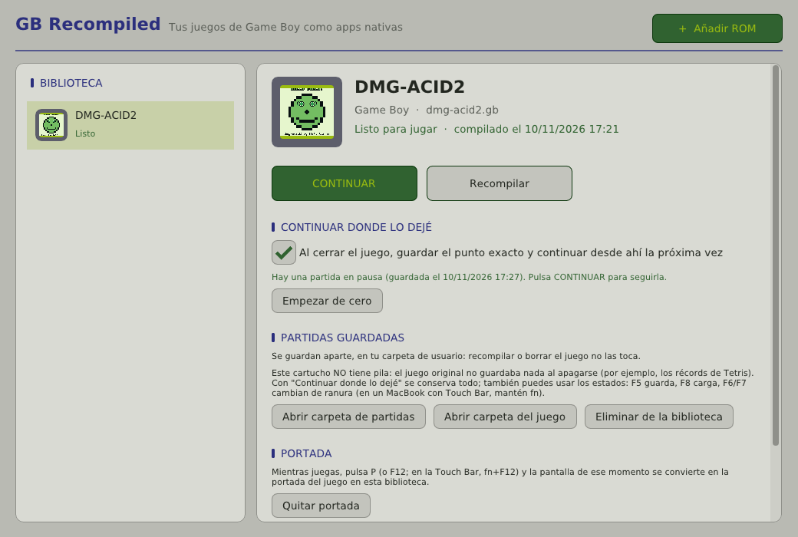
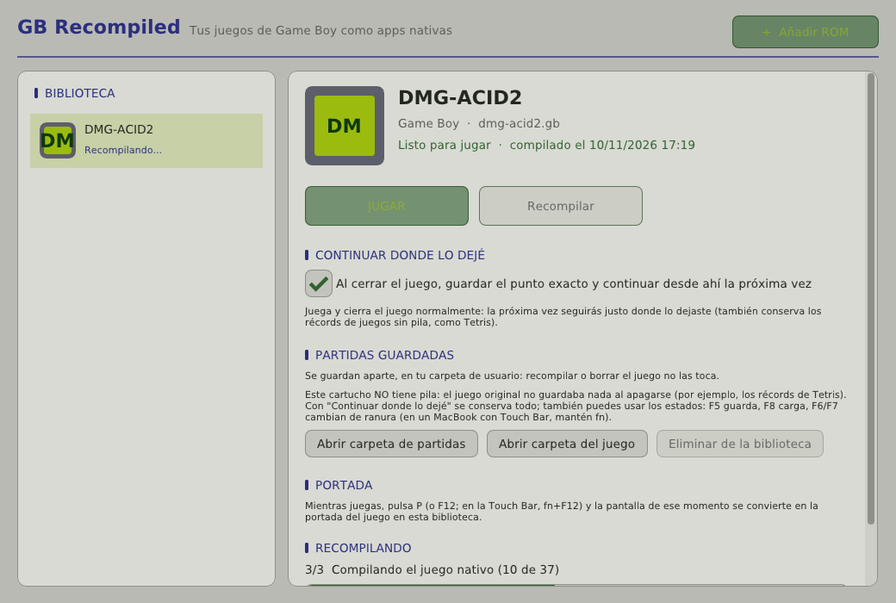
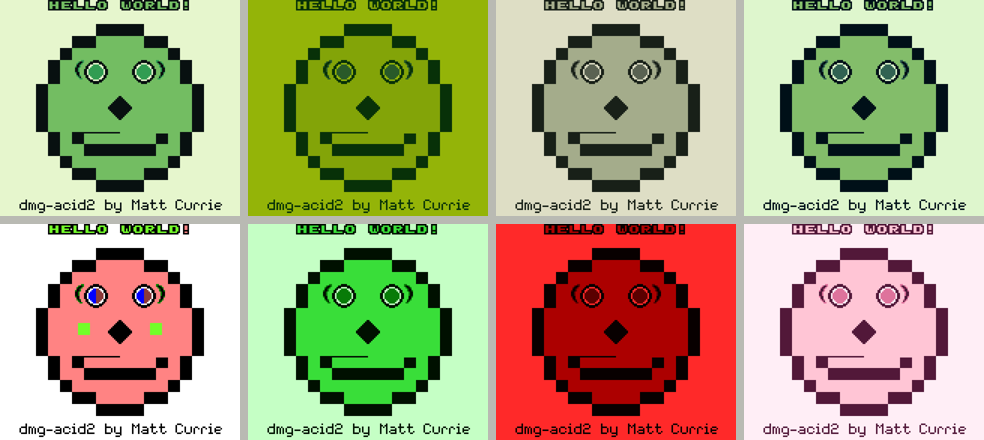
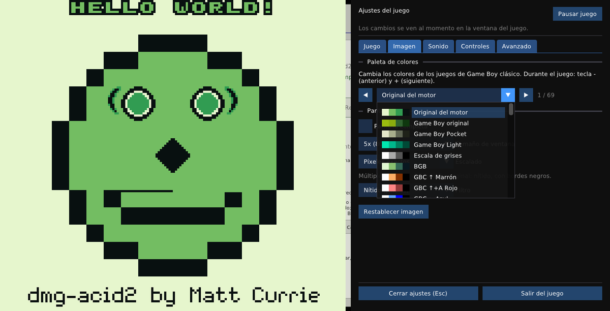
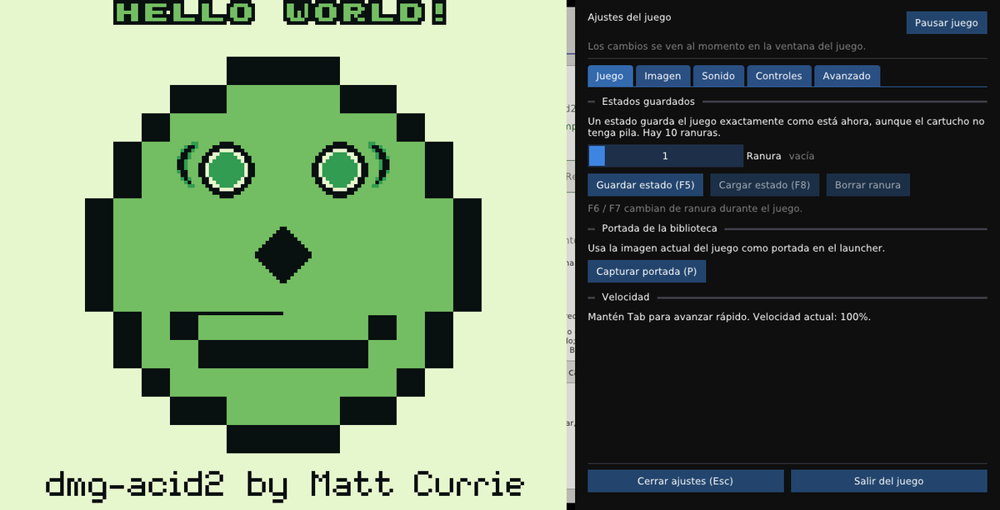

# GB Recompiled para Mac

**Guía de uso del launcher** · [Sobre este fork y el proyecto original](#10-sobre-este-fork-y-el-proyecto-original)

**GB Recompiled.app** convierte tus ROMs de Game Boy y Game Boy Color en juegos
nativos de macOS **sin usar la Terminal**: abres la app, eliges la ROM y pulsas
**Recompilar**. La app ejecuta por dentro el recompilador (`gbrecomp`), CMake y
Ninja, y deja el juego en tu biblioteca listo para **Jugar**.



> Este repositorio es un fork de [arcanite24/gb-recompiled](https://github.com/arcanite24/gb-recompiled).
> El recompilador es el del proyecto original, sin cambios. El fork añade el
> launcher (`launcher/`), el instalador (`macos/install.sh`) y estas mejoras al
> runtime de los juegos:
> **autoguardado de la pila**, **portadas**, **68 paletas de color** con `-`/`+`
> y un **menú de ajustes en español, en su propia ventana**, para ver los
> cambios en vivo. El código original, sin estos añadidos, está en la rama
> [`upstream-main`](https://github.com/gabom88/gb-recompiled-mac/tree/upstream-main)
> (ver [sección 10](#10-sobre-este-fork-y-el-proyecto-original)).

---

## 1. Instalación (una sola vez)

Necesitas un Mac (probado como objetivo: MacBook Pro 16" 2019, Intel), conexión
a Internet durante la instalación y unos 2 GB libres.

**Paso 1 — Xcode Command Line Tools** (compilador de Apple):

```bash
xcode-select --install
```

Si dice que ya están instaladas, sigue al paso 2.

**Paso 2 — Homebrew** (si no lo tienes; compruébalo con `brew --version`):

```bash
/bin/bash -c "$(curl -fsSL https://raw.githubusercontent.com/Homebrew/install/HEAD/install.sh)"
```

**Paso 3 — Descargar este repositorio:**

```bash
git clone https://github.com/gabom88/gb-recompiled-mac.git ~/gb-recompiled-mac
```

**Paso 4 — Instalar la app:**

```bash
~/gb-recompiled-mac/macos/install.sh
```

El script instala solo lo que falte (`cmake`, `ninja`, `sdl2`), compila el
recompilador y el launcher, crea **GB Recompiled.app** en tu carpeta
**Aplicaciones** de usuario (`~/Applications`) y la abre.

> ⏳ En un Mac **Intel**, Homebrew ya no tiene paquetes precompilados y compila
> CMake y SDL2 en tu equipo: la primera vez puede tardar **15–40 minutos**. Si ves
> una línea como `==> ./bootstrap …` que parece congelada, no lo está.

---

## 2. Uso diario (todo con el ratón)

1. Abre **GB Recompiled** desde Launchpad, Spotlight o Finder › Aplicaciones.
2. Pulsa **+ Añadir ROM** y elige tu archivo `.gb` o `.gbc`. También puedes
   **arrastrarlo** a la ventana.
3. La app lo recompila sola: verás el progreso paso a paso (traducir a C,
   preparar y compilar). En un i9 tarda unos **20–60 segundos** por juego.
   **Ver detalles** muestra lo que hacen las herramientas por dentro.
4. Cuando diga *"listo para jugar"*, pulsa **JUGAR** (o **CONTINUAR**, si dejaste
   una partida a medias).



| Botón | Qué hace |
|---|---|
| **JUGAR** / **CONTINUAR** | Abre el juego. *CONTINUAR* aparece cuando hay una partida en pausa (sección 3). |
| **Recompilar** | Vuelve a generar el juego (por ejemplo, tras actualizar la app). **No borra tus partidas.** |
| **Empezar de cero** | Descarta la partida en pausa: la próxima vez el juego empieza desde el principio. |
| **Abrir carpeta de partidas** | Muestra en Finder los `.sav`, los estados y la portada de ese juego. |
| **Abrir carpeta del juego** | La copia de la ROM, el proyecto generado y los registros (`build.log`, `last_run.log`). |
| **Eliminar de la biblioteca** | Borra la copia y la compilación; tú decides si también sus partidas. |

Las ROMs conocidas se reconocen y se compilan con ajustes verificados; por
ejemplo **Tetris V1.1** (con *Korobeiniki* en A-TYPE) y **Tetris V1.0**.

---

## 3. Partidas guardadas

Cada juego guarda sus partidas en su propia carpeta, **fuera** de la
compilación, así que recompilar o actualizar la app no las toca:

```
~/Library/Application Support/GB Recompiled/
├── games/<juego>/   ROM, proyecto generado y registros
└── saves/<juego>/   .sav (pila), .rtc (reloj), .state1…10 (estados),
                     resume.state (partida en pausa) y cover.bmp (portada)
```

Hay tres formas de guardar:

- **Continuar donde lo dejé** (activado por defecto, en la ficha de cada juego).
  Al cerrar el juego se guarda el punto exacto, y la próxima vez el botón
  **CONTINUAR** te devuelve justo ahí. Sirve para cualquier juego, también los
  que **no tienen pila**: con Tetris conservas la tabla de récords mientras
  sigas continuando. **Empezar de cero** descarta esa partida en pausa. Si
  tras una actualización del motor la partida en pausa ya no es compatible, la
  app lo detecta, la aparta (`resume-incompatible-….state`) y empieza el juego
  desde el principio.
- **Guardado del propio juego (pila del cartucho).** Los juegos con pila, como
  Pokémon o Zelda, guardan cuando guardas dentro del juego, como en la consola.
  El `.sav` se escribe **al momento**, en cuanto el juego termina de guardar
  (en 1–3 segundos), y no solo al cerrar. Así no se pierde aunque el juego se
  cuelgue, uses *Forzar salida* o se apague el Mac.
- **Estados (en cualquier juego):** **F5** guarda, **F8** carga y **F6/F7**
  cambian de ranura (hay 10). En un MacBook con Touch Bar, mantén **fn**.
  También desde la pestaña *Juego* del menú `Esc`.

> **Tetris no tiene pila en el cartucho**: en la Game Boy original los récords
> se borraban al apagarla. Con *Continuar donde lo dejé* se conservan.

---

## 4. Paletas de color



Los juegos de **Game Boy clásico** pueden mostrarse con **69 paletas**: la
original del motor y las **68 de GemuBoy**. Entre ellas están Game Boy Pocket,
Light, BGB, las coloraciones de arranque de la Game Boy Color, Matrix, Virtual
Boy, Sepia, Sakura, Ciberpunk…

- Durante el juego: **`-`** paleta anterior, **`+`** paleta siguiente. Abajo
  aparece el nombre, por ejemplo *"Paleta 8/69: GBC ↑+A Rojo"*.
- O en el menú `Esc` › **Imagen**, con una lista que muestra los cuatro colores
  de cada paleta.
- Las paletas **"GBC …"** colorean los sprites aparte del fondo, como hace una
  Game Boy Color: en *GBC ↑+A Rojo*, por ejemplo, las piezas de Tetris salen
  verdes sobre fondo rojo.
- La paleta elegida se recuerda para la próxima vez.
- Los juegos de **Game Boy Color** usan sus propios colores, así que ahí no
  cambia nada.



---

## 5. Portadas de la biblioteca

Mientras juegas, pulsa **`P`** (o **`F12`**; en la Touch Bar, **fn+F12**) y la
pantalla de ese momento se convierte en la **portada** del juego en la
biblioteca. Verás el aviso *"Portada capturada para la biblioteca"* y el
launcher la muestra al instante, aunque el juego siga abierto. Puedes capturar
otra cuando quieras, o pulsar **Quitar portada** en la ficha del juego.

---

## 6. Controles y menú del juego

| Game Boy | Teclado |
|---|---|
| Cruceta | Flechas (o `W` `A` `S` `D`) |
| A / B | `Z` / `X` (o `J` / `K`) |
| Start / Select | `Return` / `Delete` (o `Shift` derecho) |

| Atajo | Acción |
|---|---|
| `Esc` | Abre o cierra la **ventana de ajustes** (junto al juego, sin taparlo). |
| `-` / `+` | Paleta anterior / siguiente. |
| `Tab` (mantener) | Avance rápido. |
| `F5` / `F8` | Guardar / cargar estado (`F6`/`F7` cambian de ranura). |
| `P` o `F12` | Capturar la portada para la biblioteca. |
| `M` | Silenciar. |

**Los ajustes** (`Esc`) se abren en **una ventana aparte**, junto a la del juego:

- **Los cambios se ven al momento** en la ventana del juego, sin que el menú la
  tape: paletas, escalado, pantalla completa…
- Si la pantalla tiene sitio, la ventana del juego se desplaza a la izquierda
  para que las dos quepan lado a lado.
- El juego **sigue corriendo** mientras ajustas. Si prefieres detenerlo, pulsa
  **Pausar juego** en la propia ventana de ajustes.
- `Esc` (en cualquiera de las dos ventanas) o **Cerrar ajustes** la cierran;
  cerrarla nunca cierra el juego. Lo que escribas en ella no llega al juego,
  salvo cuando estás asignando un control.



| Pestaña | Contenido |
|---|---|
| **Juego** | Estados guardados (ranura, guardar, cargar, borrar), capturar portada. |
| **Imagen** | Paleta de colores, pantalla completa, tamaño de ventana, escalado y filtro. |
| **Sonido** | Activar sonido, silenciar, volumen y dispositivo de salida. |
| **Controles** | Botones del Game Boy y atajos, para teclado y mando (clic y pulsa la nueva tecla). |
| **Avanzado** | Lo técnico: velocidad, V-Sync, rendimiento en pantalla, latencia de audio y diagnóstico del recompilador. |

**Escalado** (pestaña *Imagen*). Útil al maximizar la ventana o en pantalla
completa:

| Modo | Resultado |
|---|---|
| **Píxeles exactos** | Múltiplos exactos del tamaño original: lo más nítido, con bordes negros. |
| **Ajustar** | Lo más grande posible sin deformar; puede dejar bordes. |
| **Llenar (recorta)** | Cubre toda la ventana sin deformar; **recorta** arriba/abajo o a los lados. |
| **Estirar** | Ocupa **toda la ventana sin recortar nada**; la imagen se deforma. |

El escalado y el filtro elegidos se recuerdan.

Las opciones que solo sirven para ports especiales (como el panel del port de
Pokémon Crystal) ya no aparecen en los juegos normales.

---

## 7. Actualizar

```bash
cd ~/gb-recompiled-mac && git pull && ./macos/install.sh
```

Tu biblioteca y tus partidas se conservan. **Después pulsa *Recompilar* en cada
juego**: las mejoras del runtime (paletas, menú, autoguardado…) viajan dentro de
cada juego compilado. Los estados de una versión anterior pueden no cargar; los
`.sav` de la pila siempre se mantienen.

---

## 8. Solución de problemas

| Síntoma | Solución |
|---|---|
| Aviso *"Falta algo para poder recompilar"* | Pulsa **Instalar con Homebrew** en ese aviso, o ejecuta `brew install cmake ninja sdl2`. |
| *"No encuentro el recompilador o su runtime"* | Vuelve a ejecutar `./macos/install.sh`. |
| Error al recompilar | Pulsa **Ver detalles** o abre `build.log` con **Abrir carpeta del juego**. |
| El juego se cierra al abrirlo | Mira `last_run.log` en la carpeta del juego. |
| macOS dice que no puede abrir la app | Clic derecho sobre la app › **Abrir** › **Abrir** (solo la primera vez). |
| `-`/`+`, el menú nuevo o `P` no funcionan | Ese juego se compiló con una versión anterior: pulsa **Recompilar**. |
| `F5`/`F8`/`F12` no hacen nada | En la Touch Bar mantén **fn**, o usa `P` para la portada. |
| *"No se pudo continuar la partida anterior"* | Era de otra versión del motor: se apartó y el juego empezó de cero. |
| Las paletas no cambian nada | Es un juego de Game Boy Color: usa sus propios colores. |
| Al maximizar se corta la imagen arriba y abajo | Está en **Llenar (recorta)**. Para ocupar toda la ventana sin recortar elige **Estirar**; para no deformar, **Ajustar**. |
| La paleta no cambia mientras el juego está en pausa | Es normal: el cambio se ve en cuanto pulsas **Reanudar juego**. |

---

## 9. Cómo funciona por dentro

```
ROM ──► gbrecomp ──► proyecto C (+ copia del runtime) ──► cmake + ninja ──► juego nativo
```

- El launcher (`launcher/main.cpp`) usa **SDL2 + Dear ImGui**, las mismas piezas
  que el runtime, así que no añade dependencias nuevas.
- Lanza las herramientas como procesos aparte y muestra su salida en directo.
  Ninja informa de su progreso (`[n/m]`) y con eso se calcula la barra.
- Ejecuta cada juego con opciones del runtime original: `--save-dir
  saves/<juego>` y, con *Continuar*, `--save-state-file` / `--load-state-file
  resume.state`.
- **Cambios al runtime** (documentados en [RUNTIME.md](RUNTIME.md)):
  - `platform_sdl.cpp`: autoguardado de la pila, acción de portada, paletas con
    `-`/`+`, ventana de ajustes aparte (con pausa opcional), escalado guardado y fuente con tildes.
  - `ppu.c`: paleta opcional por capa (fondo, OBP0, OBP1). Sin paleta elegida,
    la salida es idéntica a la original.
  - `gb_display_palettes.h`: las 68 paletas importadas de GemuBoy.
  - Como el port de Pokémon Crystal fija la huella del runtime, se actualizó
    `ports/pokemon-crystal/standalone/gbrecomp-contract.json`.
- Con `-DGBRECOMP_BUILD_LAUNCHER=ON` se compila junto al resto del proyecto. Por
  defecto está desactivado, así que la compilación normal del proyecto original
  no cambia.

**Cómo se probó** (en Linux, sin un Mac físico), con una ROM real de Tetris
V1.1:

- **Básico:** añadir, recompilar (~21 s), jugar, F5/F8.
- **Portada:** con `P` se creó `cover.bmp` y la biblioteca la mostró.
- **Paletas:** con `-`/`+` y desde el menú; en *GBC Rojo*, la pieza (sprite)
  sale verde sobre fondo rojo.
- **Ventana de ajustes:** se abre junto al juego (que se desplaza para dejarle
  sitio), las cinco pestañas funcionan, la paleta cambia en vivo desde ella, se
  abrió y cerró 3 veces seguidas sin perder el teclado del juego, y **Salir del
  juego** cerró todo guardando la partida en pausa.
- **Escalado:** con la ventana del juego en formato ancho, *Ajustar* deja
  bordes, *Llenar* recorta arriba y abajo y *Estirar* ocupa toda la ventana sin
  recortar.
- **Continuar:** al cerrar se creó `resume.state` y CONTINUAR volvió al mismo
  punto (*"Loaded execution state"*). Con un `resume.state` corrupto, la app lo
  apartó y abrió el juego desde el principio.
- **Pila:** con una ROM propia de cartucho MBC1 + pila, el `.sav` llegó a
  1 → 2 → 3 **cerrando el juego a la fuerza** (`kill -9`).

Batería de pruebas del repo: 83/85; los 2 fallos también ocurren sin estos
cambios. Las pruebas externas de PPU (Blargg/Mooneye) no se pudieron ejecutar
aquí porque esas ROMs no están disponibles. **Pendiente de confirmar en un
Mac:** el selector de archivos de macOS, arrastrar a la ventana, el icono y la
`.app`.

> Las capturas de esta guía usan la ROM de prueba libre
> [dmg-acid2](https://github.com/mattcurrie/dmg-acid2) (licencia MIT), no juegos
> comerciales. La línea que se ve en su "boca" es una imprecisión del motor
> original de la PPU, no de este fork.

---

## 10. Sobre este fork y el proyecto original

| Dónde | Qué hay |
|---|---|
| Rama [`main`](https://github.com/gabom88/gb-recompiled-mac) (esta) | El proyecto completo con el launcher para Mac, el instalador y las mejoras del runtime. |
| Rama [`upstream-main`](https://github.com/gabom88/gb-recompiled-mac/tree/upstream-main) | El `main` original del proyecto en el momento del fork, **sin** los añadidos para Mac. |
| [arcanite24/gb-recompiled](https://github.com/arcanite24/gb-recompiled) | El proyecto original, que sigue evolucionando. |
| [docs/README-upstream.md](docs/README-upstream.md) | El README original (en inglés): arquitectura, uso de `gbrecomp` por línea de comandos, Android, ports, precisión… |

Documentación técnica del proyecto original: [RUNTIME.md](RUNTIME.md) (controles y
opciones del runtime), [ACCURACY.md](ACCURACY.md), [GBC.md](GBC.md),
[ANDROID.md](ANDROID.md).

Licencia: la del proyecto original, en [LICENSE](LICENSE).
