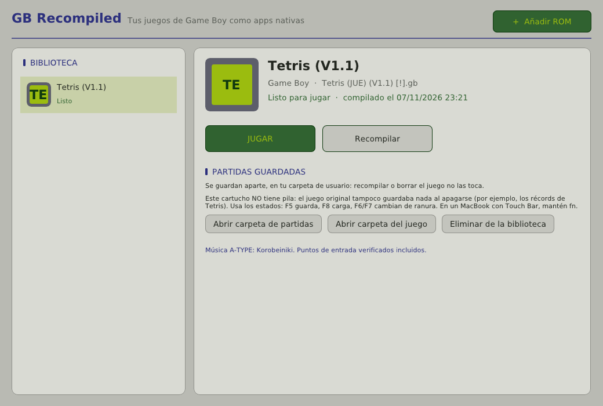

# GB Recompiled para Mac — guía del launcher

**GB Recompiled.app** convierte tus ROMs de Game Boy y Game Boy Color en juegos
nativos de macOS **sin usar la Terminal**: abres la app, eliges la ROM y pulsas
**Recompilar**. La app ejecuta por dentro el recompilador (`gbrecomp`), CMake y
Ninja, y deja el juego en tu biblioteca listo para **Jugar**.



> Este repositorio es un fork de [arcanite24/gb-recompiled](https://github.com/arcanite24/gb-recompiled).
> El recompilador y el runtime son los del proyecto original, sin modificar. El
> fork solo añade el launcher (`launcher/`) y el instalador (`macos/install.sh`).

---

## 1. Instalación (una sola vez)

Necesitas un Mac (probado como objetivo: MacBook Pro 16" 2019, Intel), conexión
a Internet durante la instalación y unos 2 GB libres.

**Paso 1 — Xcode Command Line Tools** (compilador de Apple):

```bash
xcode-select --install
```

Si dice que ya están instaladas, sigue al paso 2.

**Paso 2 — Homebrew** (si no lo tienes; compruébalo con `brew --version`):

```bash
/bin/bash -c "$(curl -fsSL https://raw.githubusercontent.com/Homebrew/install/HEAD/install.sh)"
```

**Paso 3 — Descargar este repositorio:**

```bash
git clone https://github.com/gabom88/gb-recompiled-mac.git ~/gb-recompiled-mac
```

**Paso 4 — Instalar la app:**

```bash
~/gb-recompiled-mac/macos/install.sh
```

El script instala solo lo que falte (`cmake`, `ninja`, `sdl2`), compila el
recompilador y el launcher, crea **GB Recompiled.app** en tu carpeta
**Aplicaciones** de usuario (`~/Applications`) y la abre.

> ⏳ En un Mac **Intel**, Homebrew ya no tiene paquetes precompilados y compila
> CMake y SDL2 en tu equipo: la primera vez puede tardar **15–40 minutos**. Si ves
> una línea como `==> ./bootstrap …` que parece congelada, no lo está.

---

## 2. Uso diario (todo con el ratón)

1. Abre **GB Recompiled** desde Launchpad, Spotlight o Finder › Aplicaciones.
2. Pulsa **+ Añadir ROM** y elige tu archivo `.gb` o `.gbc`. También puedes
   **arrastrarlo** a la ventana.
3. La app lo recompila sola: verás el progreso paso a paso (traducir a C,
   preparar y compilar). En un i9 tarda unos **20–60 segundos** por juego.
   **Ver detalles** muestra lo que hacen las herramientas por dentro.
4. Cuando diga *"listo para jugar"*, pulsa **JUGAR**.

| Botón | Qué hace |
|---|---|
| **JUGAR** | Abre el juego en su propia ventana. |
| **Recompilar** | Vuelve a generar el juego (por ejemplo, tras actualizar la app). **No borra tus partidas.** |
| **Abrir carpeta de partidas** | Muestra en Finder los `.sav` y los estados guardados de ese juego. |
| **Abrir carpeta del juego** | La copia de la ROM, el proyecto generado y los registros (`build.log`, `last_run.log`). |
| **Eliminar de la biblioteca** | Borra la copia y la compilación; tú decides si también sus partidas. |

Las ROMs conocidas se reconocen y se compilan con ajustes verificados; por
ejemplo **Tetris V1.1** (con *Korobeiniki* en A-TYPE) y **Tetris V1.0**.

---

## 3. Partidas guardadas

Cada juego guarda sus partidas en su propia carpeta, **fuera** de la
compilación, así que recompilar o actualizar la app no las toca:

```
~/Library/Application Support/GB Recompiled/
├── games/<juego>/   ROM, proyecto generado y registros
└── saves/<juego>/   .sav (pila), .rtc (reloj) y .state1…10 (estados)
```

Hay dos formas de guardar:

- **Guardado del propio juego (pila del cartucho).** Los juegos con pila, como
  Pokémon o Zelda, guardan cuando guardas dentro del juego, como en la consola.
- **Estados (en cualquier juego):** **F5** guarda, **F8** carga y **F6/F7**
  cambian de ranura (hay 10). En un MacBook con Touch Bar, mantén **fn**.

> **Tetris no tiene pila en el cartucho.** En la Game Boy original los récords
> también se borraban al apagarla. Para continuar una partida, usa **F5/F8**.

---

## 4. Controles del juego

| Game Boy | Teclado |
|---|---|
| Cruceta | Flechas |
| A / B | `Z` / `X` |
| Start / Select | `Return` / `Shift` derecho |

| Atajo | Acción |
|---|---|
| `Esc` | Menú de ajustes del juego (controles, sonido, imagen, ranuras). |
| `Tab` (mantener) | Avance rápido. |
| `F5` / `F8` | Guardar / cargar estado. |

La lista completa está en [RUNTIME.md](../RUNTIME.md).

---

## 5. Actualizar

```bash
cd ~/gb-recompiled-mac && git pull && ./macos/install.sh
```

Tu biblioteca y tus partidas se conservan. Si una actualización cambia el
motor, pulsa **Recompilar** en cada juego. Los estados de una versión anterior
pueden no cargar; los `.sav` de la pila siempre se mantienen.

---

## 6. Solución de problemas

| Síntoma | Solución |
|---|---|
| Aviso *"Falta algo para poder recompilar"* | Pulsa **Instalar con Homebrew** en ese aviso, o ejecuta `brew install cmake ninja sdl2`. |
| *"No encuentro el recompilador o su runtime"* | Vuelve a ejecutar `./macos/install.sh`. |
| Error al recompilar | Pulsa **Ver detalles** o abre `build.log` con **Abrir carpeta del juego**. |
| El juego se cierra al abrirlo | Mira `last_run.log` en la carpeta del juego. |
| macOS dice que no puede abrir la app | Clic derecho sobre la app › **Abrir** › **Abrir** (solo la primera vez). |
| `F5`/`F8` no hacen nada | En la Touch Bar mantén **fn**. |

---

## 7. Cómo funciona por dentro

```
ROM ──► gbrecomp ──► proyecto C (+ copia del runtime) ──► cmake + ninja ──► juego nativo
```

- El launcher (`launcher/main.cpp`) usa **SDL2 + Dear ImGui**, las mismas piezas
  que el runtime, así que no añade dependencias nuevas.
- Lanza las herramientas como procesos aparte y muestra su salida en directo.
  Ninja informa de su progreso (`[n/m]`) y con eso se calcula la barra.
- Ejecuta cada juego con `--save-dir saves/<juego>`, una opción del runtime
  original.
- Con `-DGBRECOMP_BUILD_LAUNCHER=ON` se compila junto al resto del proyecto. Por
  defecto está desactivado, así que la compilación normal del proyecto original
  no cambia.

**Cómo se probó** (en Linux, sin un Mac físico): con una ROM real de Tetris
V1.1 se comprobaron añadir, recompilar (~21 s), jugar, guardar con F5,
recompilar y cargar con F8, y que el estado sobrevivió. También se probaron el
aviso de dependencias y el rechazo de archivos que no son ROMs. El launcher
compila sin avisos con GCC y Clang. **Pendiente de confirmar en un Mac:** el
selector de archivos de macOS, arrastrar a la ventana, el icono y la `.app`.
